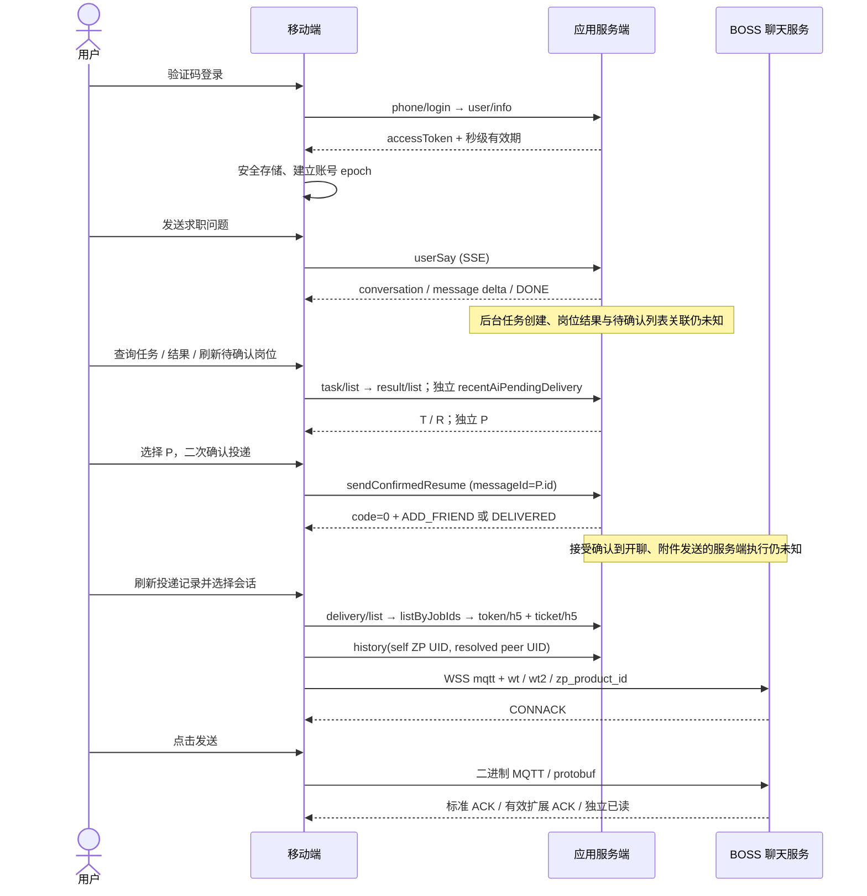

# 牛人快跑移动端

`packages/mobile` 是 Vue + Capacitor 移动端，`packages/ai-sdk` 是从前序分析导入的独立 SDK。首版交付 Android APK，iOS 工程保留但不作为本次发布目标。桌面自动化工程仍由原有 Node/Electron/Puppeteer 流程运行。

默认进入体验空间。示例岗位、招聘方与消息均为虚构；体验操作不会调用真实服务。没有内置生产域名、账号、Token、验证码服务或服务端模拟成功逻辑。

## 本地开发与打包

使用 Node.js 24、pnpm 8.15.9。Android 需要 JDK 21、Android SDK platform 36 / build-tools 36.0.0。

```sh
pnpm install --frozen-lockfile --ignore-scripts
pnpm mobile:test
pnpm mobile:build
pnpm --filter geekgeekrun-mobile dev
# 桌面 Chrome 路径不在标准位置时设置 CHROME_EXECUTABLE_PATH
node packages/mobile/scripts/smoke.mjs
pnpm --filter geekgeekrun-mobile exec cap sync android
cd packages/mobile/android
./gradlew --no-daemon assembleDebug assembleRelease lintRelease
```

Debug APK 可直接安装用于测试；`app-release-unsigned.apk` 必须经过分发密钥签名才可安装。源码不包含分发密钥。使用同一 applicationId 后续升级时必须继续使用同一密钥并递增 versionCode。

```sh
# 将本机 SDK 的 build-tools/36.0.0 加入 PATH；密钥与密码文件放在仓库外
packages/mobile/scripts/sign-apk.sh \
  packages/mobile/android/app/build/outputs/apk/release/app-release-unsigned.apk \
  /private/path/release.jks /private/path/password.txt geekgeekrun \
  /private/path/geekgeekrun-0.1.0.apk
```

GitHub Actions 的 `Mobile apps` 流水线会验证 SDK / 移动端、运行无外部请求的体验流程，构建测试 APK 与未签名 release APK。默认不运行 iOS；手动触发时可勾选 `include_ios` 检查预留的模拟器工程。没有 TestFlight 上传步骤。

## 真实服务接入

在“我的 → 服务连接”配置拥有使用权限的 HTTPS API origin。此地址必须是 origin，不含路径、查询参数或账号。短信登录使用 SDK 还原的 APP 登录协议；没有已验证的刷新 Token 接口，过期后要求重新登录。原生凭证通过 Android Keystore / iOS Keychain 保存，网页预览仅存内存。

“获取验证码”需要服务方提供验证页面：应用通过系统浏览器打开 `verificationUrl`，携带 `phone`、随机 `state` 和 `redirect_uri=geekgeekrun://auth/proof`。页面完成真实验证后，应将实际 proof JSON 编码到回调 URL 的 `proof` 参数，并原样返回 `state`。应用仅接受当前发起的一次回调与已还原的验证码类型 1/3/4，再调用 `sendPhoneCode`。这是**新增的应用接入契约**，不是已经观察到的服务端能力；没有此页面时只能输入从服务方已获取的有效短信码。未实现、未声称验证码绕过。

原生网络桥接使用系统 TLS，拒绝 HTTP/WSS 之外的非加密连接和跨地址重定向；当前不导入浏览器 Cookie，也不自动保存网络 Cookie。若生产登录依赖 Cookie、设备证明或额外请求头，需要真实响应证据后补充。不要将 App Bearer 当作 BOSS IM ticket。

## 数据边界与调用链

| 值                                | 来源                                          | 使用位置                              |
| --------------------------------- | --------------------------------------------- | ------------------------------------- |
| AI conversation_id / message.id   | SSE create_conversation / delta.add；历史查询 | 对话上下文的 conversation_id / parent |
| task.id                           | 独立 task/list(conversationId)                | result/list(taskId)                   |
| task result.id                    | 独立 result/list                              | 结果展示；不会自动成为投递 ID         |
| 待确认 P.id                       | 独立 recentAiPendingDelivery                  | sendConfirmedResume.messageId         |
| P.content.job_info.jobId / bossId | 被用户选中的同一待确认行                      | sendConfirmedResume.jobDetail         |
| 投递记录 K.id                     | 独立 delivery/list                            | 会话列表标识，不充当 AI ID            |
| BOSS jobId / peer UID             | 记录快照与 listByJobIds 独立补查              | history、IM 收发                      |
| cmid / mid                        | 本机发送 / 有效的扩展 ACK                     | 分别跟踪排队、服务器确认与已读        |

移动端通过 SDK 0.2.1 新增的 `selectPendingRow` / `confirmPending` 支持独立待确认列表。它不要求编造 AI task/result → 待确认行关系；保留原有 `bindPendingDelivery` 的运行时关联证明要求。账号 epoch 绑定与 ID 精度检查继续生效。BOSS 独立补查必须匹配请求的岗位 ID，不能采用列表中的无关招聘方；历史状态非 0 时不建立发送会话。



SSE DONE 仅结束当前回复；应用不会据此伪造任务完成、待确认项或投递记录。工作模式候选只显示提示，不自动调用 applyAgentWorkMode、开启代理、发隐藏指令或调整办公室设置。服务端账号原有代理设置仍可能生效，应在接入前核对；本应用的人工确认流程不等于关闭了服务端自动化。

确认投递只在 `code=0` 且状态为 `ADD_FRIEND` / `DELIVERED` 时接受，不能据此认定简历附件已送达。写请求、SSE 和 IM 消息不会自动重放。结果不明时提示先刷新核对。BOSS 标准 PUBACK 仅显示服务器已接收；有效扩展 ACK 与独立已读分别更新。切换账号会清空内存视图并断开旧连接，后台切换会停止流与聊天连接，返回前台需手动重连。

## 尚未取得运行时证据

1. 正式 API origin、账号准入、验证码厂商 proof、短信与登录完整响应、额外 Cookie / 设备证明。
2. 当前部署的 SSE patch 形状与消息历史顺序；应用在 DONE 后刷新规范消息，未知 patch 不猜测解释。
3. taskId、task_result_id、AI messageId 与待确认 P.id 的服务端关联、创建时机和去重机制。
4. 确认被接受后实际开聊 / 投递 / 附件发送与记录创建的时序。
5. 三种代理模式、JOB_SEEKING / MARKET_WATCHING 的服务端持久化、冲突优先级与并发行为。
6. 生产 BOSS 票据、握手、历史结构、扩展 ACK / 已读及失效重连。
7. Android 真机的短信回调、Keystore 恢复、后台行为、系统 WebView 兼容性。iOS 仅预留工程，本次没有设备构建、签名或上传。

最小取证应使用专用测试账号，逐步捕获脱敏的请求 / 响应、SSE 事件与关联 ID，并记录应用版本、账号 epoch 和时间。先只读查任务与状态；实际投递和发消息仅在明确选定测试岗位与招聘方后执行一次，并通过独立记录确认，避免用客户端提示替代服务端结果。

## 发布与隐私

这是独立客户端，不代表 BOSS 或相关服务方。没有正式服务域名与账号时，APK 以体验模式交付。面向真实用户发布前，运营方需要提供真实的隐私政策、服务协议、账号注销与数据删除入口，并完成服务接入和真机验证。源码沿用仓库 AGPL-3.0-only 许可证；依赖许可见各包。
