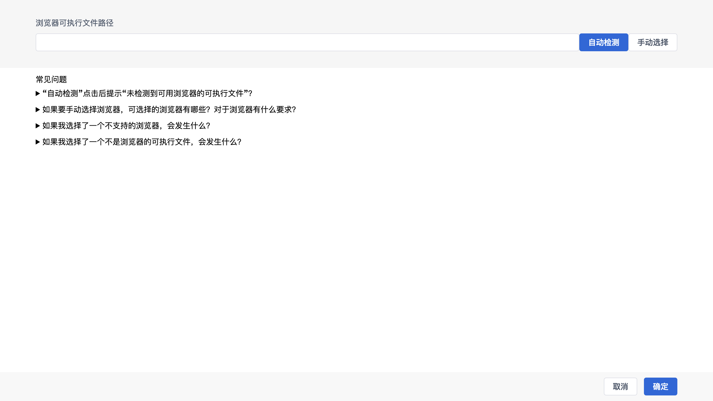

# 浏览器助手

用于选择本程序使用的浏览器可执行文件。程序基于 Puppeteer 驱动浏览器模拟操作，需要本机存在 Chrome / Edge 等受支持的浏览器。

## 操作

- **浏览器可执行文件路径**：显示当前所选浏览器路径；
- **自动检测**：自动扫描常见安装位置，寻找可用的浏览器；
- **手动选择**：手动选择浏览器可执行文件；
- **常见问题**：内置说明，包括：
  - 「自动检测」提示「未检测到可用浏览器的可执行文件」怎么办；
  - 可手动选择哪些浏览器、对浏览器有什么要求；
  - 选择了不支持的浏览器会发生什么；
  - 选择了不是浏览器的可执行文件会发生什么。

## 底部操作

- **取消**：放弃；
- **确定**：保存浏览器配置。
