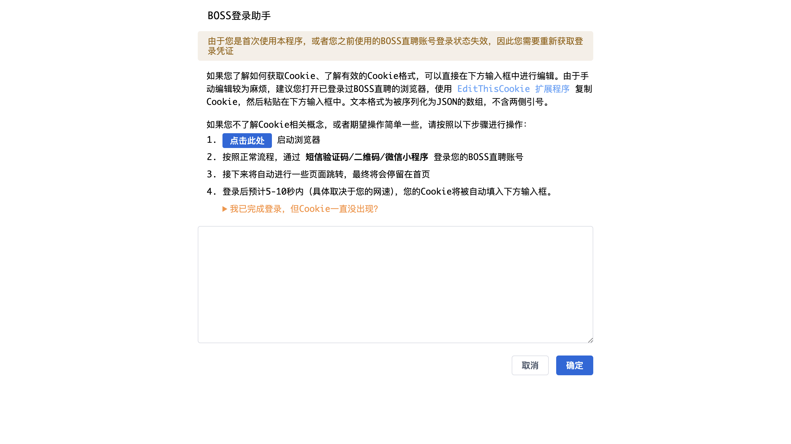

# BOSS登录助手

用于获取 / 编辑 BOSS直聘的登录凭证（Cookie）。当首次使用、或之前的登录状态失效时，需要重新获取。

## 方式一 · 手动编辑

如果你了解 Cookie 及有效格式，可直接在输入框中编辑。建议打开已登录 BOSS直聘的浏览器，用 **EditThisCookie** 扩展复制 Cookie 后粘贴。文本格式为被序列化为 JSON 的数组，不含两侧引号。

## 方式二 · 自动获取（推荐）

按以下步骤操作：

1. 点击「启动浏览器」；
2. 按正常流程，通过**短信验证码 / 二维码 / 微信小程序**登录你的 BOSS直聘账号；
3. 接下来会自动进行一些页面跳转，最终停留在首页；
4. 登录后预计 5–10 秒内（视网速而定），你的 Cookie 会被自动填入输入框。

如遇「我已完成登录，但 Cookie 一直没出现？」可点击该入口查看排查说明。

## 底部操作

- **取消**：放弃本次编辑；
- **确定**：保存 Cookie，完成登录。
