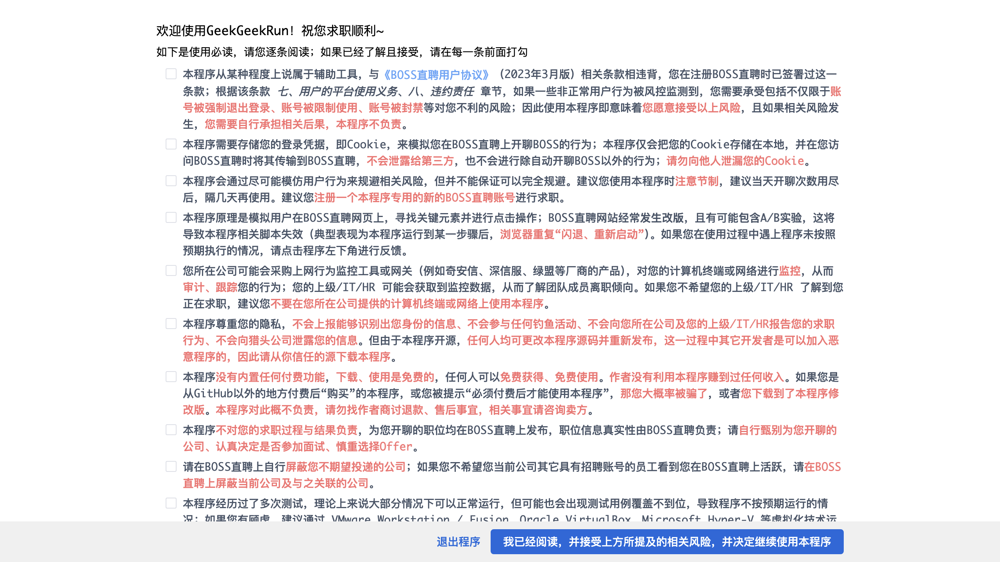

# 初次使用必读

首次启动时展示，需逐条阅读并在每条前面打勾后，才能进入主界面。这是本程序的**使用必读及免责声明**。

## 使用必读及免责声明（共 7 条）

1. **风险自担**：本程序属于辅助工具，与《BOSS直聘用户协议》（2023年3月版）相关条款相违背。使用即表示你愿意接受账号被强制退出登录、被限制使用、被封禁等风险；相关后果自行承担，本程序概不负责。
2. **Cookie 仅本地使用**：本程序仅把 Cookie 存储在本地，仅在访问 BOSS直聘时使用，不会泄露给第三方；请勿向他人泄漏你的 Cookie。
3. **注意节制**：本程序会尽可能模仿用户行为，但不能保证完全规避风控。建议当天开聊次数用尽后隔几天再使用，并注册一个专用新账号。
4. **网站改版风险**：BOSS直聘经常改版且可能包含 A/B 实验，可能导致脚本失效（典型表现为浏览器重复「闪退、重新启动」）。如遇异常请通过程序左下角反馈。
5. **公司监控风险**：你所在公司可能部署上网行为监控（奇安信、深信服、绿盟等），从而审计、跟踪你的行为。若不想让上级/IT/HR 察觉你在求职，请不要在公司提供的电脑或网络上使用。
6. **隐私与信任源**：本程序不会上报可识别你身份的信息、不会钓鱼、不会向公司或猎头泄露信息；但因开源，任何人都可改源码重新发布，请从你信任的源下载。
7. **免费声明**：本程序没有内置任何付费功能，下载、使用完全免费。若你是在 GitHub 以外付费「购买」，或被告知「必须付费才能使用」，大概率是修改版或被骗，本程序概不负责。

## 底部操作

逐条勾选全部条目后，底部「下一步 / 同意并进入」按钮才会启用，点击后进入主界面。后续可在设置相关入口重新查看本文。
