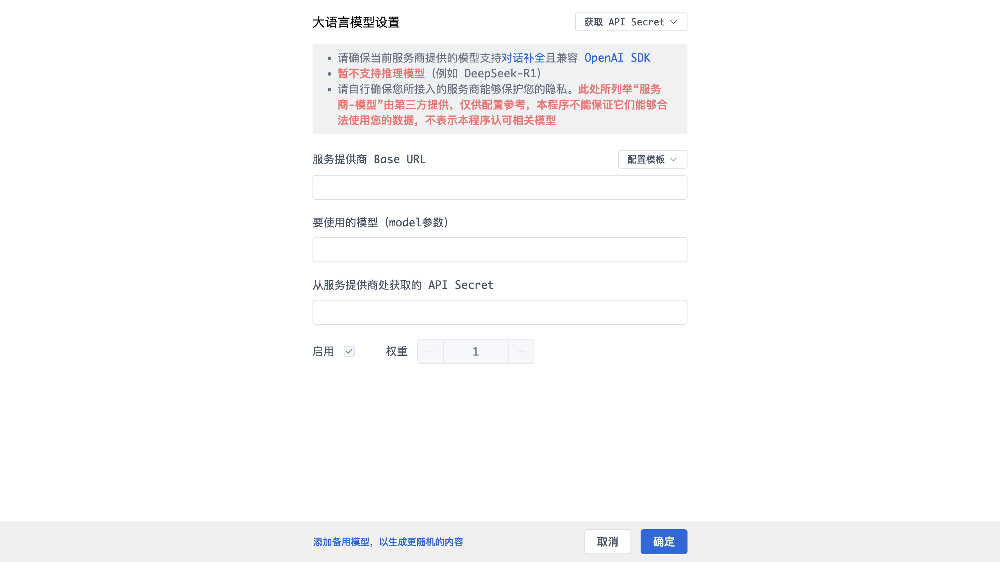

# 大语言模型设置

配置用于「已读不回自动复聊」与职位匹配的大语言模型。程序要求服务商提供的模型支持对话补全且兼容 OpenAI SDK。

## 提示与限制

- 顶部「获取 API Secret」入口指向服务商申请密钥；
- 请确保当前服务商提供的模型支持**对话补全**且**兼容 OpenAI SDK**；
- **请求与思考选项**：可在“设置 → AI助手”配置请求超时、失败重试与思考选项，并通过“测试连接”确认所选模型的兼容性；
- 请自行确保所接入服务商能够保护你的隐私；此处列举的「服务商-模型」由第三方提供，仅供配置参考。

## 配置项

- **服务提供商 Base URL**：模型接口地址；
- **配置模板**：可选的预设模板（服务商-模型组合）；
- **要使用的模型（model 参数）**：模型名称；
- **从服务提供商处获取的 API Secret**：密钥；
- **启用 / 权重**：支持多个模型，按权重随机选用，以生成更随机的内容；
- **添加备用模型**：增加备用模型。

## 底部操作

- **取消**：放弃修改；
- **确定**：保存配置。

> 主界面「设置 → AI助手」提供了更完整的选项：首选模型、启用备用模型、请求超时、失败后重试、开启思考模式、测试连接等。
