# 简历编辑

本地编辑简历。简历会作为提示词的一部分提交给大模型，仅在匹配职位、生成已读不回提醒消息时使用。

## 说明

- 大部分信息非必填，但不填写可能导致匹配到不准确的职位，或生成预料之外的提醒消息；
- **期望薪资仅用于匹配职位**，不会用作生成已读不回提醒消息。

## 字段

- **基本信息**：姓名、工作年限、期望职位、期望薪资（k）、个人优势；
- **工作经历**（可「新增一条」，支持多条）：公司名称、任职时间、职务、工作描述、工作业绩；
- **项目经历**（可「新增一条」，支持多条）：项目名称、项目角色、项目时间、项目描述、项目业绩。

## 底部操作

- **取消**：放弃修改；
- **确定**：保存简历。
