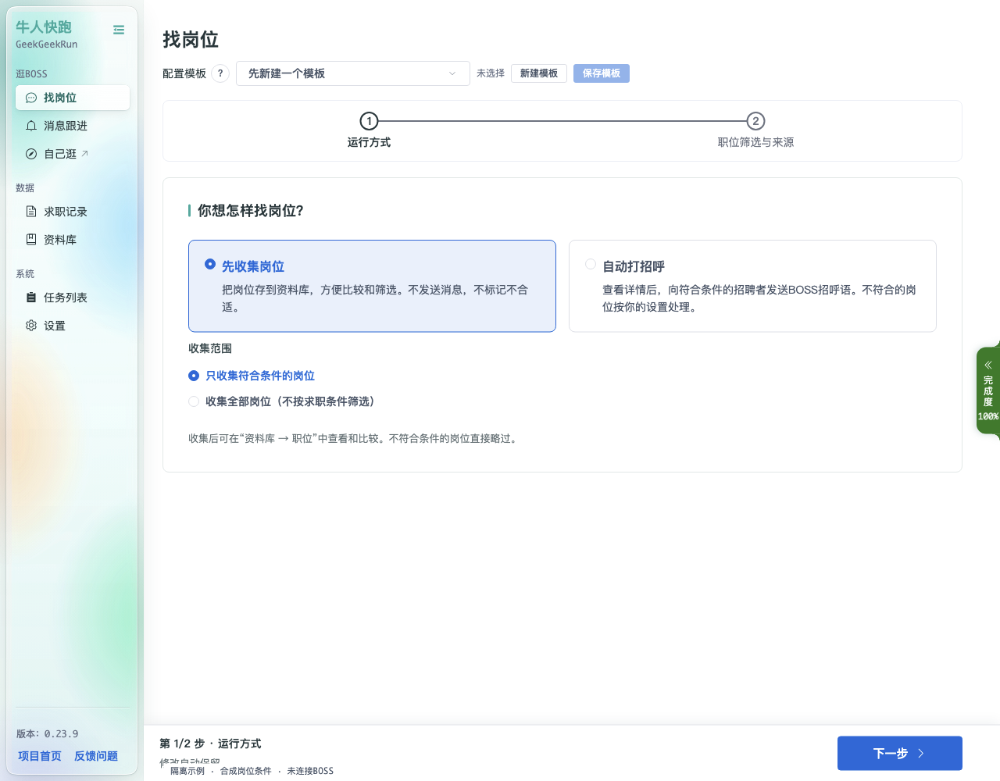

# 快速开始

先收集符合条件的岗位，再到资料库比较和筛选；需要自动打招呼时再明确开启。首次启动请阅读并确认[初次使用必读](Assistant-First-Run)。文档对应当前 `master` 桌面界面，版本说明见 [Wiki 首页](Home)。

## 第 1 步 · 配置浏览器并登录

进入 **设置 → 账号与浏览器**：

1. 自动检测或手动选择本机 Chrome / Edge，并保存浏览器配置；也可使用下载浏览器入口。
2. 点击编辑登录凭证，打开 [BOSS登录助手](Assistant-Cookie)，手动登录并完成可能出现的安全验证。
3. 回到设置确认当前 BOSS 账号已登录。

浏览器相关操作见[浏览器助手](Assistant-Browser)。

## 第 2 步 · 选择先收集岗位

进入 **找岗位**，选择“先收集岗位”，保留“只收集符合条件的岗位”。不符合条件的岗位会略过；这一方式不发送消息、不标记不合适。

如明确选择“收集全部岗位”，则收集所选来源中的岗位，不按本地求职条件筛选；职位来源范围和页面筛选仍需确认。

## 第 3 步 · 填写求职条件和来源

按下一步填写岗位关键词、工作城市、薪资和其他必需条件，选择推荐、搜索、BOSS求职期望或指定公司的岗位来源，然后确认开始收集。

只收集使用“运行方式 → 职位筛选与来源”两步；模式和定时休息可在 **设置 → 任务运行** 中统一调整。详细字段和公司来源说明见[找岗位](Screens-Find-Jobs)。

## 第 4 步 · 查看结果和任务进度

- **资料库 → 职位**：查看、比较、导出已收集岗位，使用筛选预览核对条件。
- **任务列表**：查看进度、累计用量和停止原因；暂停后使用同一任务继续，已处理岗位与累计用量保留。
- 验证或异常提示会指出下一步；发送结果待核对时不会自动重发。

详见[任务列表](Screens-Tasks)与[资料库](Screens-Library)。

## 按需开启自动打招呼、消息跟进和 AI

选择“自动打招呼”后，向导增加第三步“处理方式”，开始前需明确确认。发送内容来自 BOSS 账号设置的招呼语。每日目标、运行保护和账号检查仍会生效。

“消息跟进”对已读未回复会话执行你配置的跟进规则。若需要 AI 或简历辅助，在 **设置 → AI助手** 中配置并测试连接；普通只收集和 BOSS 招呼语发送不要求先配置 AI。相关入口见[消息跟进](Screens-Follow-Up)、[大语言模型设置](Assistant-LLM)与[简历编辑](Assistant-Resume)。
