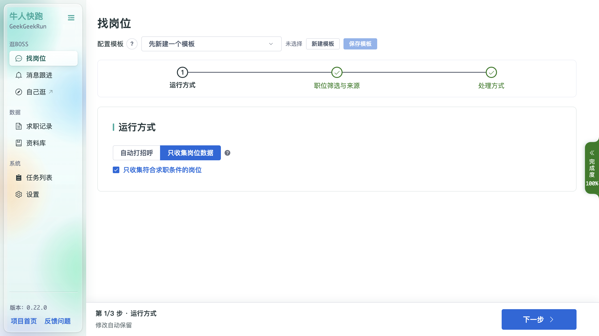
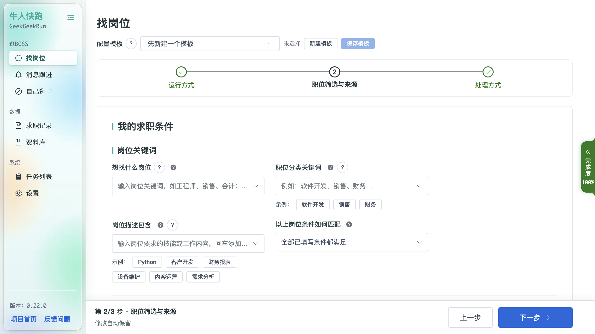
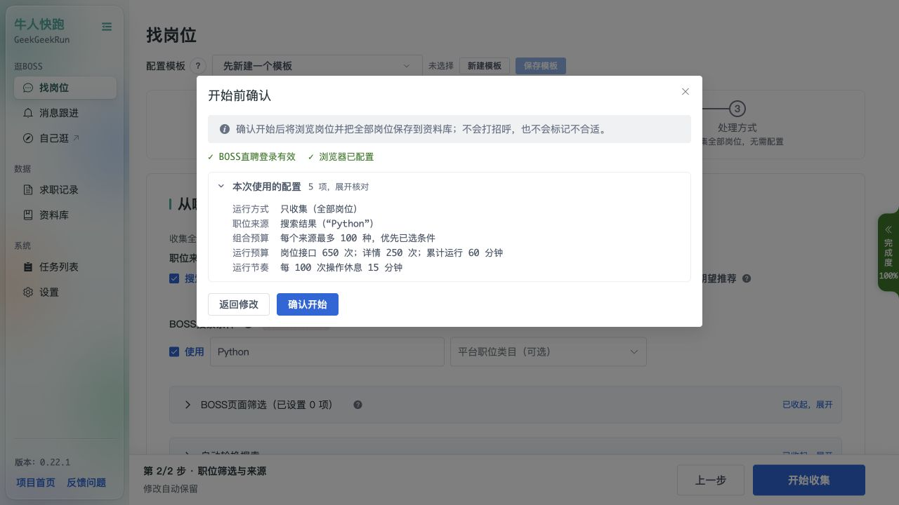
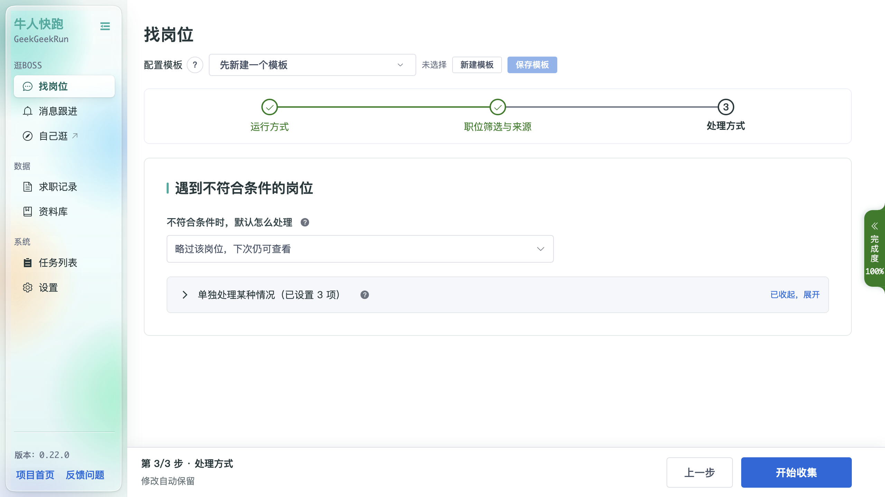

# 找岗位

「找岗位」是核心页面，用于配置「批量开聊 BOSS / 只收集岗位」的运行条件。页面顶部是**配置模板**选择器，下方是三步向导：**运行方式 → 职位筛选与来源 → 处理方式**，底部为进度条（完成度）与「上一步 / 下一步 / 开始收集」按钮，以及「修改自动保留」开关。

## 配置模板

顶部模板栏用于把当前填写好的整套条件保存为一个命名模板，方便在多个求职目标之间快速切换。

- 「先新建一个模板」「未选择」：当前未选择模板时显示；
- 「新建模板」：把当前条件另存为新模板；
- 「保存模板」：更新当前所选模板。

## 第 1 步 · 运行方式

三种运行方式：

- **自动打招呼**：找到符合条件的岗位后，自动向 BOSS 发送招呼语。发送内容为你 BOSS 账号里设置的招呼语（软件不另外生成内容），可在 BOSS直聘 App 里修改；
- **只收集岗位数据**：只收集岗位，不发送任何招呼；
- **只收集符合求职条件的岗位**：只把符合筛选条件的岗位收集进职位库。

**后台运行浏览器**默认开启：自动任务使用最小化窗口，不主动切换到前台；登录和安全验证仍会显示窗口。关闭后使用普通窗口。该选择进入配置模板、开始确认和本次任务快照；运行中修改仅对下次运行生效。后台状态无法确认时任务会暂停，可检查浏览器或关闭该选项后恢复。

## 第 2 步 · 职位筛选与来源

- **岗位关键词**：输入岗位关键词（如「工程师」「销售」「会计」），回车添加；
- **职位分类关键词**：按职位分类进一步筛选；
- **投递前必需条件**：求职类型、公司人数、岗位学历要求、行业与融资阶段。留空不限；已填写条件会逐条核对，不符合或信息不足时只略过，不在 BOSS 标记。公司人数要求岗位给出的人数范围完全符合；
- **岗位/JD屏蔽词**：名称或描述包含任一词就略过，按字面匹配并忽略大小写；留空关闭。启用后名称或描述缺失也会略过，不受正向「满足其中一项」影响，不执行标记或冷却；
- **工作地点与待遇**：期望薪资支持月薪（元）、年薪（万元）、日薪（元/天）和时薪（元/小时）。日薪、时薪不会换算为月薪；可选择是否跳过面议或无法识别薪资的岗位；
- **全国**：工作城市选择“全国”表示不限制本地城市；需要网站明确在全国召回时，同时在「BOSS页面筛选」中选择“全国”。城市选择未能确认时任务会停止，检查后可恢复；
- **公司偏好**：「只看这些公司」（白名单）与「不看这些公司」（黑名单）。

「BOSS页面筛选」的自动组合默认每个来源最多查看 100 种，可调整为 1–10000。优先使用已选条件，达到上限后换源；固定组合不受该上限限制，但仍受其它换源规则约束。暂停后恢复不会重新获得一整份组合预算。页面筛选与本地投递条件分别生效。

「预览筛选结果」用职位库最近 100 条已有岗位核对当前条件，显示学历、行业、融资阶段、类型、公司人数、原始薪资、判定原因和计划操作。只收集模式显示「可收集」或「跳过」；预览不会启动任务。日薪和时薪分别比较，薪资区间有交集即可通过，公司人数则要求整个人数范围符合。

「只收集符合求职条件的岗位」在全部条件通过后才保存详情及本轮观测；仅被网页预载或被条件拒绝的岗位不会因此入库。任务中的「已查看」不等于「已收集」。

### 平台职位类目

在「BOSS搜索条件」中，可选择平台职位类目，例如「技术 → 后端开发 → Python」，也可多选。内置码表包含 848 个具体职位类目，快照日期为 2026-10-19。

- 搜索内容与平台类目一起限制搜索范围；选择类目后，搜索内容可以留空。
- 「职位分类关键词」仍是本地条件；平台类目选择不会替代城市、薪资或投递前必需条件。
- 每组轮换搜索独立保存关键词和类目；同一关键词配不同类目会作为不同来源。模板、排队快照及运行配置会保留选择。
- 修改类目后继续任务，会重新核对来源范围；未选择类目时，来源身份仍使用原有字段。组合范围或预算变化也会重新核对恢复位置。
- 运行时会核对页面实际发出的搜索参数。无法确认类目已应用，或响应与当前条件不一致时，任务会暂停。

### 访问受限时的处理

列表每一页及详情响应都会检查访问状态。收到限制响应、无法解析的业务响应或读取超时后，任务保留进度与登录凭证并停止自动重试；正常的空列表仍按来源轮换规则处理。发送与发送确认前也会检查访问状态。

### 本次运行预算

“职位筛选与来源”中可展开“本次运行预算”，默认最多 500 次岗位接口请求、其中 200 次详情请求、累计运行 120 分钟。每项填 0 表示不限制，留空采用默认值；开始前确认会列出本次使用的上限。

次数包括失败、重试和重复请求，与入库岗位数不同。时间包括列表等待、详情停留和定时休息，不含手动暂停、排队、安全验证及浏览器重启间隔。任一预算耗尽后保存进度并暂停；提高上限后可恢复，已用额度继续累计。来源或筛选范围改变也不清零预算。

## 第 3 步 · 处理方式

- **遇到不符合条件的岗位 / 默认怎么处理**：默认「略过该岗位，下次仍可查看」；
- **单独处理某种情况**：可为特定情况设置单独的处理方式（示例中已设置 3 项，可展开查看）。

投递前必需条件始终采用“略过”，不受默认标记方式影响。「只收集全部岗位」忽略这些条件，「只收集符合求职条件的岗位」会检查这些条件。

当前主线使用单账号登录。重新登录后若身份改变，旧任务恢复会停止并提示处理，避免误用原登录身份的历史。平台限制访问、页面超时和无法确认身份时会保留登录凭证，避免反复清空重登。
