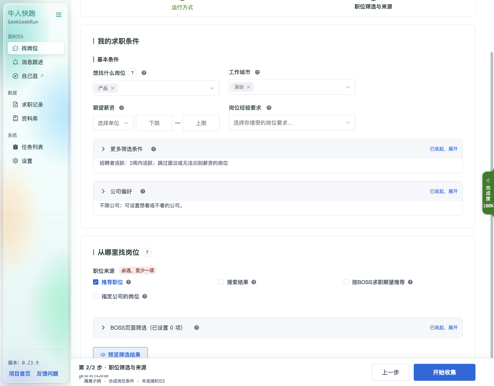

# 找岗位

「找岗位」是核心页面，用于配置「批量开聊 BOSS / 只收集岗位」的运行条件。页面顶部是**配置模板**选择器。只收集使用**运行方式 → 职位筛选与来源**两步；选择自动打招呼后增加第三步**处理方式**。底部提供完成度、步骤切换和开始按钮。

## 配置模板

顶部模板栏用于把当前填写好的整套条件保存为一个命名模板，方便在多个求职目标之间快速切换。

- 「先新建一个模板」「未选择」：当前未选择模板时显示；
- 「新建模板」：把当前条件另存为新模板；
- 「保存模板」：更新当前所选模板。

## 第 1 步 · 运行方式

先选择“先收集岗位”或“自动打招呼”：

- **先收集岗位**：默认“只收集符合条件的岗位”，不发送消息、不标记不合适；如选择“收集全部岗位”，则不按本地求职条件筛选，仍保持所选来源范围和页面条件。
- **自动打招呼**：全部条件通过后发送 BOSS 账号设置的招呼语；软件不另外生成招呼语内容，可在 BOSS直聘 App 中修改。

任务浏览器默认后台运行，登录和安全验证时会显示窗口；显示状态无法确认时先检查或更新浏览器，再继续原任务。运行模式和休息统一在“设置 → 任务运行”管理。

## 第 2 步 · 职位筛选与来源

- **岗位关键词**：输入岗位关键词（如「工程师」「销售」「会计」），回车添加；
- **职位分类关键词**：按职位分类进一步筛选；
- **投递前必需条件**：求职类型、公司人数、岗位学历要求、行业与融资阶段。留空不限；已填写条件会逐条核对，不符合或信息不足时只略过，不在 BOSS 标记。公司人数要求岗位给出的人数范围完全符合；
- **岗位/JD屏蔽词**：名称或描述包含任一词就略过，按字面匹配并忽略大小写；留空关闭。启用后名称或描述缺失也会略过，不受正向「满足其中一项」影响，不执行标记或冷却；
- **工作地点与待遇**：期望薪资支持月薪（元）、年薪（万元）、日薪（元/天）和时薪（元/小时）。日薪、时薪不会换算为月薪；可选择是否跳过面议或无法识别薪资的岗位；
- **全国**：工作城市选择“全国”表示不限制本地城市；需要网站明确在全国召回时，同时在「BOSS页面筛选」中选择“全国”。城市选择未能确认时任务会停止，检查后可恢复；
- **公司偏好**：「只看这些公司」（白名单）与「不看这些公司」（黑名单）。

「BOSS页面筛选」的自动组合默认每个来源最多查看 100 种，可调整为 1–10000。优先使用已选条件，达到上限后换源；固定组合不受该上限限制，但仍受其它换源规则约束。暂停后恢复不会重新获得一整份组合预算。页面筛选与本地投递条件分别生效。

薪资待遇、工作经验、学历要求、公司行业和公司规模会核对选中项及页面实际搜索参数，清空也会核对不限状态。无法找到或确认已请求的条件时暂停，并指出具体字段；不会跳过该条件继续处理岗位。检查页面后可在任务列表恢复。

条件选中后，还会确认页面职位列表与本次来源及条件一致，再逐条处理岗位。列表尚未同步或之后收到不同条件的结果时，任务会暂停并保留进度；真实的空结果可以正常换组合或来源。

「预览筛选结果」用职位库最近 100 条已有岗位核对当前条件，显示学历、行业、融资阶段、类型、公司人数、原始薪资、判定原因和计划操作。只收集模式显示「可收集」或「跳过」；预览不会启动任务。日薪和时薪分别比较，薪资区间有交集即可通过，公司人数则要求整个人数范围符合。

「只收集符合求职条件的岗位」在全部条件通过后才保存详情及本轮观测；仅被网页预载或被条件拒绝的岗位不会因此入库。任务中的「已查看」不等于「已收集」。

### 平台职位类目

在「BOSS搜索条件」中，可选择平台职位类目，例如「技术 → 后端开发 → Python」，也可多选。内置码表包含 848 个具体职位类目，快照日期为 2026-10-19。

- 搜索内容与平台类目一起限制搜索范围；选择类目后，搜索内容可以留空。
- 「职位分类关键词」仍是本地条件；平台类目选择不会替代城市、薪资或投递前必需条件。
- 每组轮换搜索独立保存关键词和类目；同一关键词配不同类目会作为不同来源。模板、排队快照及运行配置会保留选择。
- 修改类目后继续任务，会重新核对来源范围；未选择类目时，来源身份仍使用原有字段。组合范围或预算变化也会重新核对恢复位置。
- 运行时会核对页面实际发出的搜索参数。无法确认类目已应用，或响应与当前条件不一致时，任务会暂停。

### 指定公司的岗位

勾选“指定公司的岗位”并添加公司，填写 BOSS 公司主页链接或品牌 ID，可添加多个公司并调整来源顺序。城市、薪资、经验和学历按公司页面筛选，行业与规模按该品牌资料核验；本地求职条件和只收集范围继续生效。

页面或接口无法确认目标公司、岗位身份、登录或筛选时，任务会保留进度并停止处理当前岗位；验证完成后再按提示继续，不会把全站岗位当成这家公司。

### 访问受限时的处理

列表及详情响应、发送和发送确认前都会检查访问状态。明确的登录失效、安全验证和平台限制保持各自的处理流程；发送结果未知时不能自动重发。

短暂断网、页面切换和读取故障会保留同一任务、条件、位置和累计用量，按 5、15、30、60、120 秒退避，之后每 2 分钟重试。你可以随时暂停或结束等待；筛选重新应用三次仍未确认时需人工处理，系统不替你放宽条件。

### 运行模式与运行保护

模式、等待时间、定时休息和每日自动打招呼目标统一在“设置 → 任务运行”管理。任务页只配置求职条件、来源及处理方式；模式不会放宽筛选，也不会把只收集切换为打招呼。

安全／深度／极速的参数可点击模式旁的说明查看。安全和极速每轮最多读取 500 次岗位接口、其中 200 次详情、累计 120 分钟；深度为 1000／400 次、240 分钟。读取包含失败、重试和重复请求，与入库岗位数不同。等待及定时休息计入运行时间，手动暂停、排队、验证及退避等待不计入。

达到任一上限后，任务保存进度并暂停。需要继续时，先在设置中选择并保存运行模式，再回任务列表继续；只有新上限仍有余量时才能恢复。若仍达到上限，可结束本轮后新建任务；继续运行不会清零累计用量，换来源和筛选也不重置。

每日自动打招呼目标按账号和北京时间日期累计，范围 1—150，默认 100；它只统计本软件确认的开聊，不代表BOSS全平台剩余额度。达到目标后需明确为今天追加；只收集任务不使用开聊额度，但仍受读取和时长保护。新建任务不清零每日已用数量。

模式与恢复边界详见[找岗位运行与恢复](https://github.com/en0th/geekgeekrun/blob/master/docs/running-policy-ux.md)。旧的找岗位地址会自动进入新版页面，运行参数统一在设置中管理；来源组合上限等有效筛选控制继续保留。

## 第 3 步 · 处理方式（自动打招呼）

- **遇到不符合条件的岗位 / 默认怎么处理**：默认「略过该岗位，下次仍可查看」；
- **单独处理某种情况**：可为特定情况设置单独的处理方式（示例中已设置 3 项，可展开查看）。

投递前必需条件始终采用“略过”，不受默认标记方式影响。「只收集全部岗位」忽略这些条件，「只收集符合求职条件的岗位」会检查这些条件。

当前主线使用单账号登录。重新登录后若身份改变，旧任务恢复会停止并提示处理，避免误用原登录身份的历史。平台限制访问、页面超时和无法确认身份时会保留登录凭证，避免反复清空重登。
