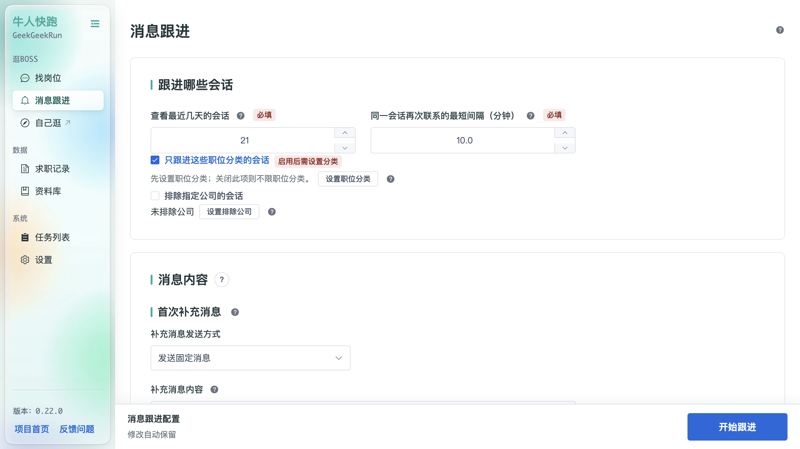

# 消息跟进（已读不回自动复聊）

「消息跟进」用于对「已读但未回复」的会话自动补充消息，避免错过潜在机会。

## 跟进范围

- **跟进哪些会话**：选择要跟进的会话类型；
- **查看最近几天的会话**：只处理最近 N 天内的会话（必填）；
- **同一会话再次联系的最短间隔（分钟）**：避免对同一会话过于频繁地补发（必填）；
- **只跟进这些职位分类的会话**：开启后仅跟进指定分类的会话，可点「设置职位分类」配置；
- **排除指定公司的会话**：点「设置排除公司」排除不跟进的公司。

## 消息内容

- **首次补充消息**：
  - 补充消息发送方式（如「发送固定消息」）；
  - 补充消息内容；
- **后续跟进消息**：
  - 后续消息发送方式（如「发送“期待回复”表情」）。

## 底部操作

- **修改自动保留**：开关；
- **开始跟进**：把「消息跟进」任务加入后台队列执行。
