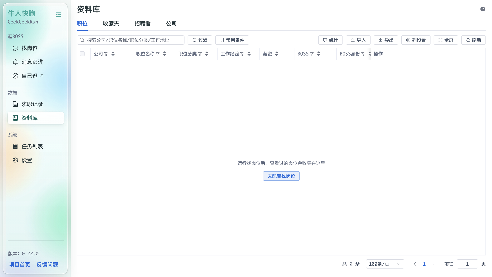
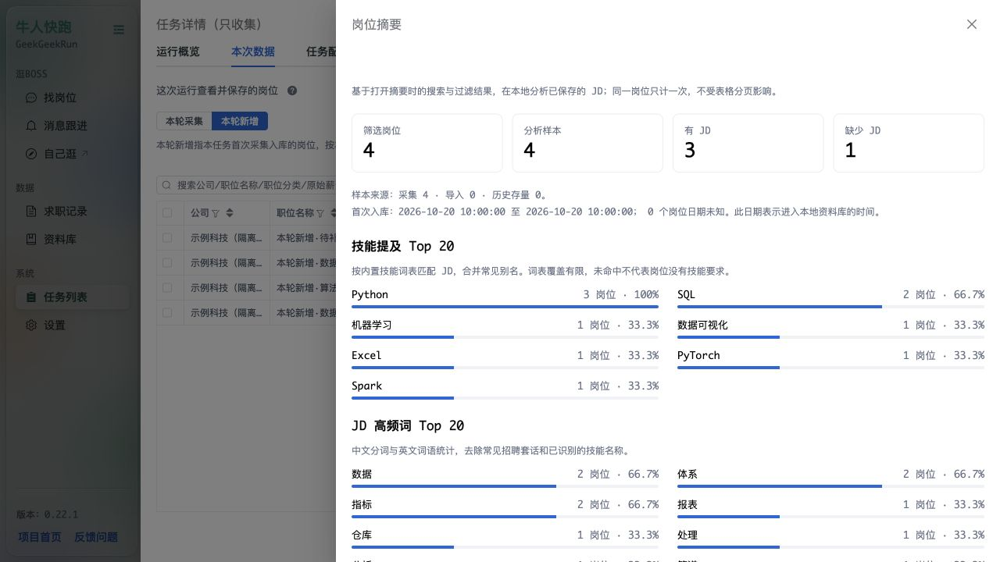
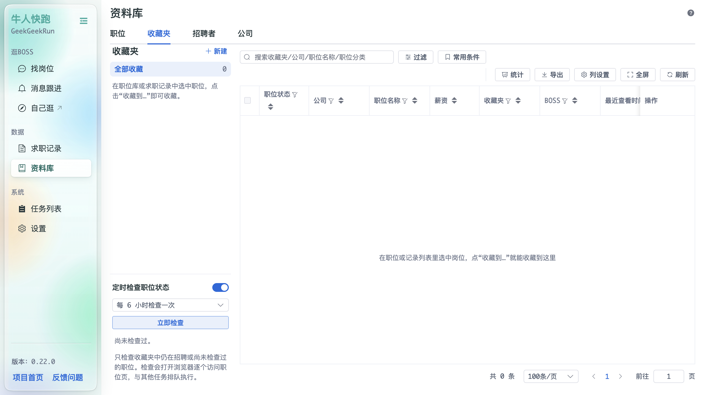
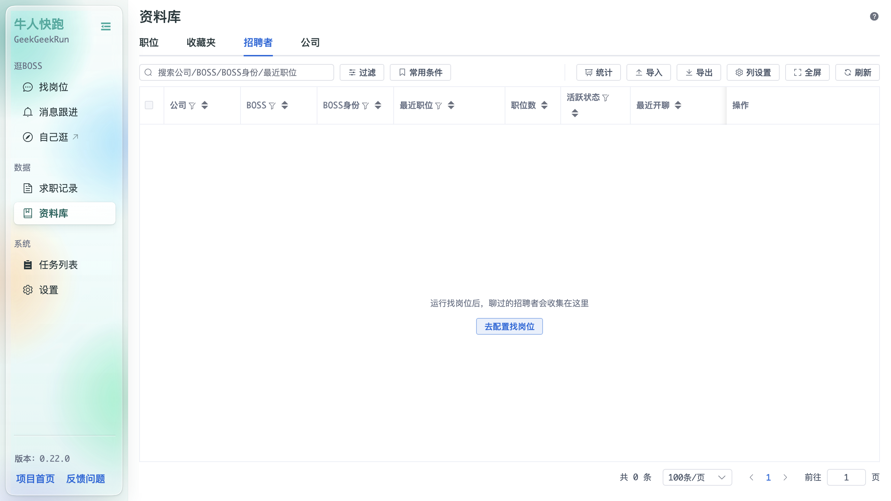
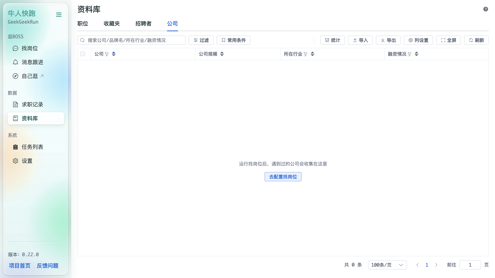

# 资料库

「资料库」沉淀程序运行过程中收集到的各类求职数据，四个标签页：**职位 / 收藏夹 / 招聘者 / 公司**，均提供工具栏：**过滤 / 常用条件 / 统计 / 导入 / 导出 / 列设置 / 全屏 / 刷新**。

## 职位

运行「找岗位」后，查看过的岗位会收集在这里。列包括：公司、职位名称、职位分类、首次入库时间、入库来源、工作经验、薪资、BOSS、BOSS身份、开聊时间、操作。“首次入库任务”“最近采集时间”可从列设置中显示，支持过滤、排序和导出。

首次入库以本地数据库的岗位 ID 去重，跨账号、跨来源共享。旧数据标为“历史存量”，首次时间未知；导入记录标为“导入”。删除详情仍保留发现台账，重新采集时不会再算首次发现。

导入职位时可选择 **boss-zhipin-scraper**，支持其 JSON 列表、JSON 详情和 CSV。先预览并查看告警，再确认写入。稳定岗位 ID 优先使用 `encrypt_job_id`，CSV 可从有效 BOSS 岗位链接提取；MD5 `job_id` 不作主键。scraper 的 `boss_name` 作为公司品牌，招聘者姓名保持缺失；缺少 ID 时不生成虚构关系，缺 JD 时不清空已有描述。

“最近导入格式 / 导入源采集时间（原文）/ 最近导入时间 / 最近导入文件”可在职位库列设置中打开。来源时间不等于平台发布时间或本库首次入库时间，无时区不推断时区。离线导入不会关联外部任务编号，也不会自动开聊。详细字段映射和缺失处理见[能力复核](../docs/scraper-followup-2026-10-22.md)。

职位和收藏夹工具栏均有“岗位摘要”，对打开时的当前搜索、过滤结果做本地分析，展示样本数、JD 覆盖率、来源、入库时间范围、技能提及与 JD 高频词。相同岗位只计一次；词语占比以有 JD 的岗位数为分母。超过 5,000 个岗位会提示采样，过长的 JD 会披露截断。技能词表覆盖有限，提及不代表必需或熟练程度。

## 收藏夹

- 顶部：「新建」收藏夹、「全部收藏」数量、以及「定时检查职位状态」（默认每 6 小时检查一次，可「立即检查」）；检查会打开浏览器逐个访问职位页，与其它任务排队执行；
- 列表列：职位状态、公司、职位名称、薪资、收藏夹、BOSS、最近查看时间、关闭时间、收藏时间、操作；
- 空状态提示「在职位或记录列表里选中岗位，点“收藏到…”就能收藏到这里」。

## 招聘者（BOSS）

运行「找岗位」后，聊过的招聘者会收集在这里。列包括：公司、BOSS、BOSS身份、最近职位、职位数、活跃状态、最近开聊、访问链接、操作。

## 公司

按公司维度聚合的数据（公司、相关字段与操作）。
