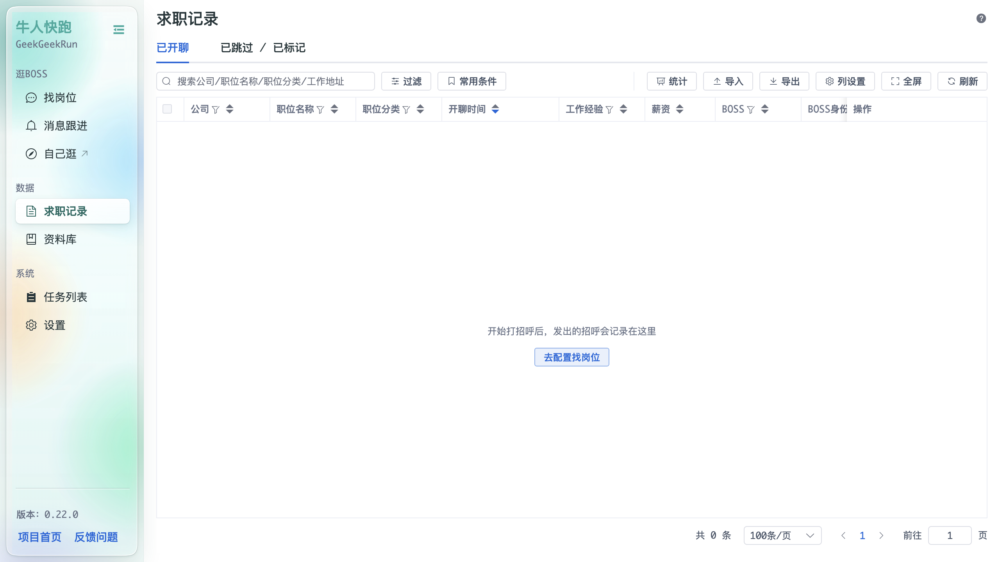
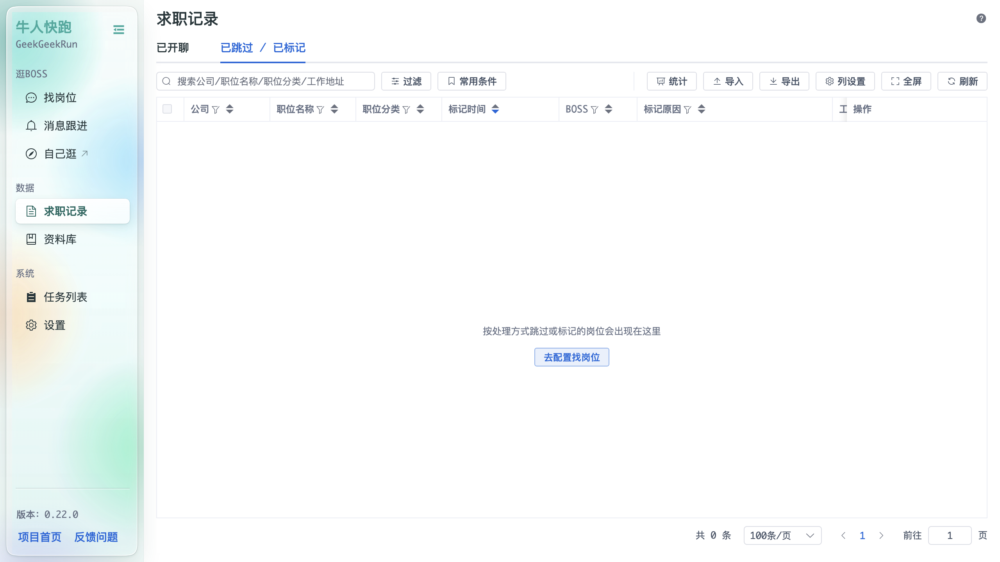

# 求职记录

「求职记录」汇总你通过本程序发出的招呼与跳过 / 标记的岗位，两个标签页共用工具栏：**过滤 / 常用条件 / 统计 / 导入 / 导出 / 列设置 / 全屏 / 刷新**。

## 已开聊

记录每条已发出的招呼，列包括：公司、职位名称、职位分类、开聊时间、工作经验、薪资、BOSS、BOSS身份、操作。空状态提示「开始打招呼后，发出的招呼会记录在这里」。

## 已跳过 / 已标记

记录按处理方式被跳过或标记的岗位，列包括：公司、职位名称、职位分类、标记时间、BOSS、标记原因、工作经验、薪资、操作。空状态提示「按处理方式跳过或标记的岗位会出现在这里」。
