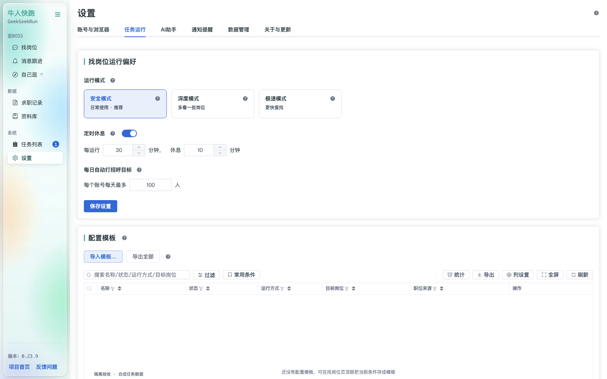

# 设置

「设置」分为六类：**账号与浏览器 / 任务运行 / AI助手 / 通知提醒 / 数据管理 / 关于与更新**。

## 账号与浏览器

- **BOSS账号与登录**：显示 BOSS直聘登录状态（已登录 / 未登录）；
- **编辑登录凭证**：打开 [BOSS登录助手](Assistant-Cookie) 获取 / 编辑 Cookie；
- **打开BOSS网站**：直接打开 BOSS直聘网站；
- **重新检测**：重新检测登录状态。

### 浏览器

- **浏览器已配置**：显示浏览器配置状态；
- **浏览器可执行文件路径**：自动检测 / 手动选择 / 下载浏览器；
- **保存浏览器配置**：保存修改。详见 [浏览器助手](Assistant-Browser)。

## 任务运行

- **运行模式**：安全／深度／极速。点击模式旁的说明查看等待时间和读取／时长保护；深度扩大覆盖范围，极速提高读取强度，模式不放宽求职条件，安全模式也不能保证免于平台验证。
- **定时休息**：按连续运行分钟计时，默认每运行 30 分钟休息 10 分钟；休息结束先重新核对登录、原账号和每日目标。
- **每日自动打招呼目标**：默认每账号 100 人，范围 1—150。按账号及北京时间日期累计，不随新建、恢复、切号或重启清零；它统计本软件确认的开聊，不代表BOSS剩余额度。输入无效时保留输入并提示原因，不能保存。

修改后点击“保存设置”，新任务和继续任务使用所选运行策略，已运行或排队的任务保留其冻结参数。达到每日目标后，需明确仅为今天追加，软件合计最多 150；平台拒绝开聊或发送结果未确认时不能直接追加后继续。只收集任务不使用开聊额度，但仍受读取与时长保护。

“配置模板”也位于任务运行中：支持**导入模板… / 导出全部**和名称、状态、运行方式、目标岗位、来源等列表信息。模板保留求职条件，不覆盖提交时的全局运行策略。完整边界见[找岗位运行与恢复](../docs/running-policy-ux.md)。

## AI助手

配置用于「已读不回自动复聊」与职位匹配的大模型：

- **首选模型**：服务商预设（如 DeepSeek）、模型名称、接口地址（Base URL）、API密钥、启用备用模型；
- **请求设置**：请求超时（秒）、失败后重试（次）、开启思考模式；
- 底部：清空配置 / 测试连接 / 保存配置。详见 [大语言模型设置](Assistant-LLM)。

## 通知提醒

通过钉钉群机器人推送通知：填写「群机器人 AccessToken」并保存。未配置时显示「钉钉通知未开启」。

## 数据管理

- **数据保存位置**：当前数据目录（默认 / 打开 / 更换到…），支持「复制当前数据到新目录」「使用新目录中已有的数据」后「更换并重启」；
- **数据库备份**：备份周期（每天）、备份方式（保留多份 / 只保留最新一份）、最多保留份数、备份目录（默认 / 更改… / 打开）、立即备份；
- **运行日志**：记录级别（信息 info）、保存时长（天）、日志目录。

配置与登录状态使用逐文件原子保存。同批设置或 cookie/localStorage 保存会先准备完整内容和回滚副本；失败时报告错误并尝试恢复上一版。读取到损坏 JSON 或权限错误时保留原文件，不再删除并重建默认值；关键任务会暂停，修正文件或恢复对应备份后可继续。

回滚未能完成时，会保留可用的 `*.rollback.tmp` 私有副本；核对并恢复时应先停止相关任务。配置在运行目录的 `config/`，登录状态在当前数据目录，SQLite 单库备份不包含这些 JSON 文件。详细范围及恢复边界见[JSON 写入加固记录](../docs/runtime-json-hardening-2026-10-20.md)。

## 关于与更新

- **自动检测更新**：默认开启，启动时及每 30 分钟检测。关闭后立即停止自动检测和当前自动请求，重启后仍保持关闭。
- **立即检测更新**：无论自动检测是否开启，都可以手动检测；检测失败会明确提示。
- **忽略此版本**：新版本提示旁和更新设置中均可操作；记住指定版本，之后的自动检测不再提示它，更高版本仍会提示。旧界面的新版本区域也提供该按钮。
- **恢复已忽略版本的提示**：清空忽略列表。手动检测也可以查看已经忽略的版本。

这些设置即时保存到运行目录的 `config/update.json`，不随求职配置模板切换。
