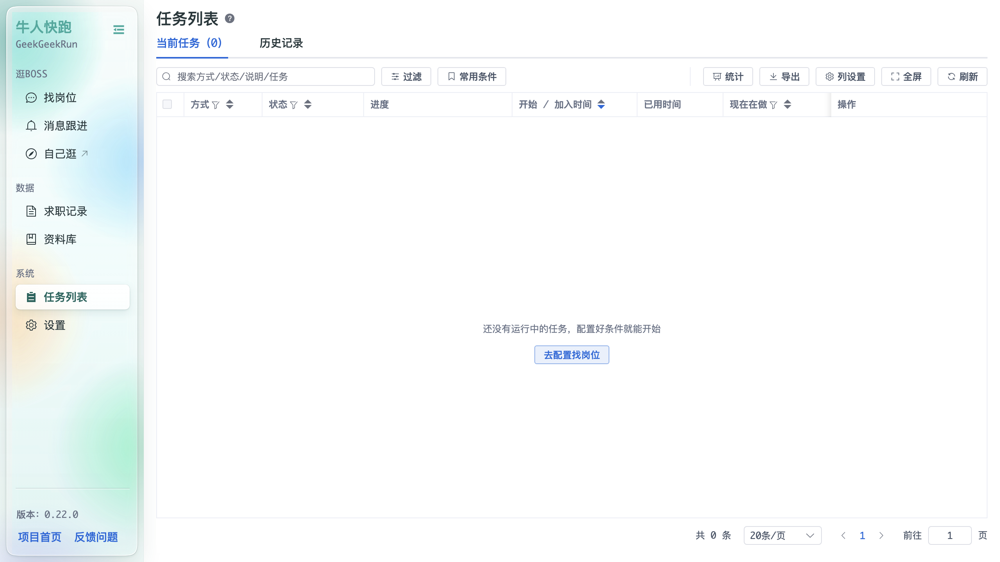
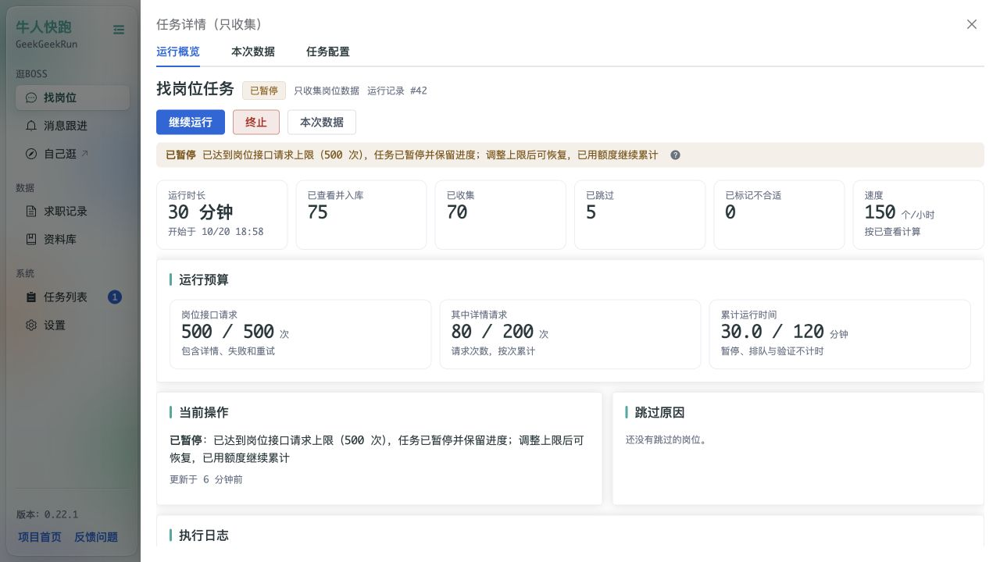
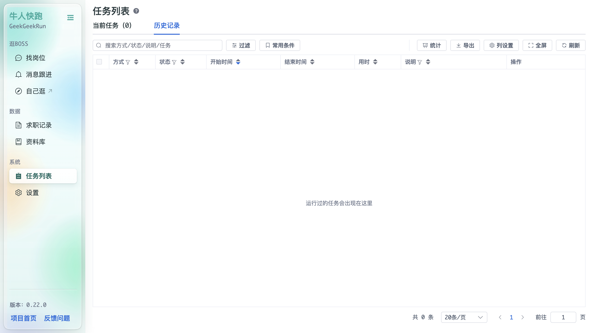
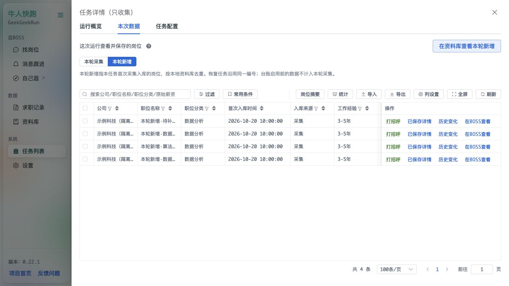

# 任务列表

「任务列表」展示后台守护进程中的任务运行情况，两个标签页共用工具栏：**过滤 / 常用条件 / 统计 / 导出 / 列设置 / 全屏 / 刷新**。

## 当前任务

列：方式、状态、进度、开始 / 加入时间、已用时间、现在在做、操作。空状态提示「还没有运行中的任务，配置好条件就能开始」，可点「去配置找岗位」直接跳转。

找岗位任务详情新增“运行预算”，显示岗位接口请求、其中详情请求和累计运行时间的用量/上限。达到上限后任务保持可恢复；先到找岗位页提高上限，再点“继续运行”，已用量不会归零。请求数包含失败和重试，与保存岗位数不同；验证、暂停及排队不计运行时间。旧任务启用预算前的用量未知时会单独提示。

## 历史记录

列：方式、状态、开始时间、结束时间、用时、说明、操作。空状态提示「运行过的任务会出现在这里」。

只收集任务的“查看详情 → 本次数据”按运行编号显示实际采集的岗位，可切换“本轮采集 / 本轮新增”。新增指本次任务首次进入本地资料库的岗位；暂停恢复沿用同一编号，旧数据和导入数据不会被算作本轮新增。台账启用前的采集无法重建完整任务归属。

此处也能生成当前范围的岗位摘要，或点“在资料库查看本轮新增”跳转为首次任务编号过滤。岗位详情及摘要使用资料库当前保存的内容。

> 任务由后台守护进程串行执行：同一时间只有一个任务在「现在在做」，其余排队等待。
